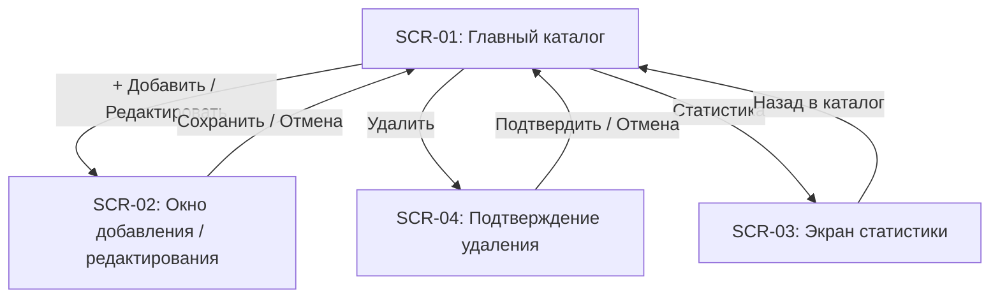

# Проектирование пользовательского интерфейса (GameTracker)

## 1. Список экранов приложения

В соответствии с брифом интерфейс состоит из **3 экранов** и **1 окна подтверждения**:

1. **SCR-01: Главный каталог игр** — таблица коллекции, поиск по названию, фильтры (по жанру и статусу), сортировка (по году и оценке) и кнопки управления.
2. **SCR-02: Окно добавления / редактирования игры** — единая модальная форма для создания новой карточки или изменения существующей.
3. **SCR-03: Экран статистики** — сводные цифры (всего игр, средняя оценка), распределение по 3 статусам и топ-5 жанров/разработчиков.
4. **SCR-04: Диалог подтверждения удаления** — предупреждение перед удалением игры.

---

## 2. Описание экранов

### Экран 1 (SCR-01): Главный каталог игр
* **Элементы управления:**
  * Поле ввода `SearchInput` («Поиск по названию...»).
  * Выпадающие списки: `GenreFilter` («Все жанры» + список из БД), `StatusFilter` («Все статусы», «В планах», «В процессе», «Завершено»), `SortSelect` («Новые», «По году (сначала новые)», «По оценке (высокая)», «По названию (А-Я)»).
  * Таблица `GamesTable` (колонки: `ID`, `Название`, `Год`, `Жанры`, `Разработчики`, `Статус`, `Оценка`).
  * Кнопки: `[+ Добавить]`, `[Редактировать]`, `[Удалить]`, `[Статистика]`.
* **Реакция и обработка ошибок:**
  * Ввод в поиск или смена фильтра сразу обновляют таблицу. Если совпадений нет — таблица пуста, внизу выводится статус «Ничего не найдено».
  * Кнопки «Редактировать» и «Удалить» срабатывают только при выделенной строке (иначе выводится подсказка выбрать игру).

### Экран 2 (SCR-02): Окно добавления / редактирования игры
* **Элементы управления:**
  * Поля ввода: `Название игры *`, `Год выхода`.
  * Выпадающие списки: `Статус *` («В планах», «В процессе», «Завершено»), `Оценка` («Без оценки» или `1..10`).
  * Списки с чекбоксами: `Жанры *` (множественный выбор) и `Разработчики` (множественный выбор) + мини-поля для быстрого добавления нового жанра/студии.
  * Кнопки: `[Сохранить]` и `[Отмена]`.
* **Реакция и обработка ошибок:**
  * При открытии в режиме редактирования поля и галочки автоматически заполняются данными выбранной игры.
  * При нарушении правил (пустое название, не выбран жанр, неверный год) выводится окно ошибки, форма не закрывается.

### Экран 3 (SCR-03): Экран статистики
* **Отображаемые данные:**
  * Карточки: «Всего игр: N», «Средняя оценка: X.X».
  * Блок распределения по статусам («В планах», «В процессе», «Завершено» — количество и процент).
  * Таблицы «Топ-5 жанров» и «Топ-5 разработчиков».
* **Управление:** Кнопка `[← Назад в каталог]`.

---

## 3. Схема переходов между экранами

---

## 4. Пошаговые сценарии взаимодействия

1. **Добавление игры:** На главном экране (SCR-01) пользователь нажимает `[+ Добавить]` $\rightarrow$ открывается форма (SCR-02) $\rightarrow$ вводит название, год, отмечает жанры, разработчика, статус и оценку $\rightarrow$ нажимает `[Сохранить]` $\rightarrow$ форма закрывается, игра появляется в таблице SCR-01.
2. **Поиск и фильтрация:** На экране SCR-01 пользователь вводит часть названия в строку поиска и выбирает статус «В процессе» $\rightarrow$ таблица мгновенно перерисовывается, оставляя только подходящие строки.
3. **Просмотр статистики:** Пользователь нажимает `[Статистика]` на SCR-01 $\rightarrow$ открывается SCR-03 с общим числом игр, средним баллом и топ-5 жанров $\rightarrow$ нажимает `[← Назад в каталог]` для возврата.
